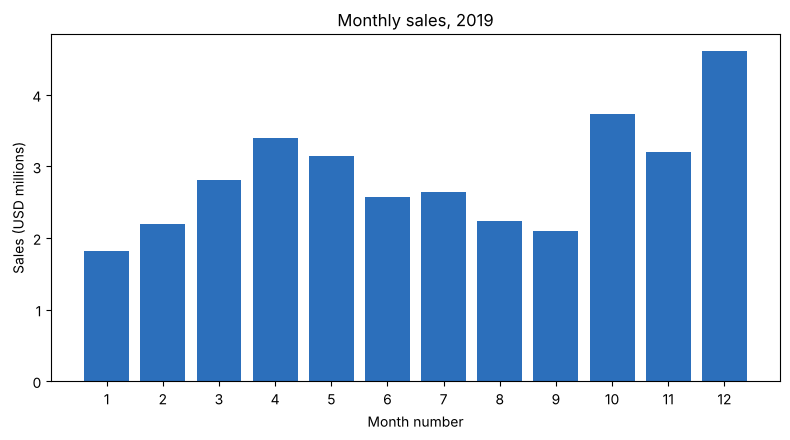
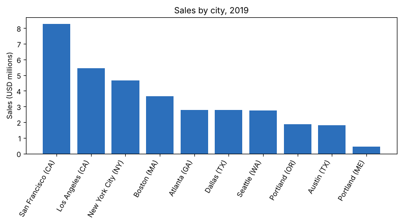
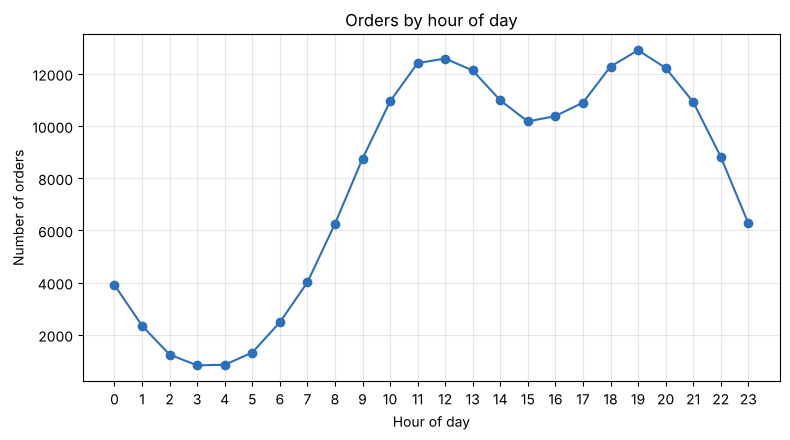
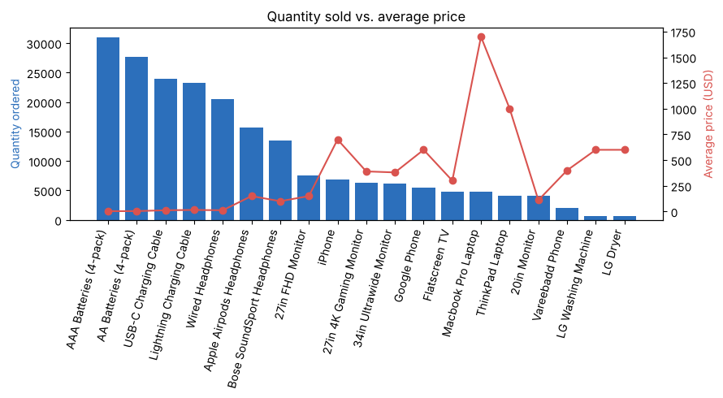

# Sales Analysis Project

Exploratory analysis of a 2019 US electronics sales dataset using Python, Pandas and Matplotlib.
The goal was to answer five practical business questions: which month and city sell the most, when to show ads, which products are bought together, and how price relates to units sold.

## Dataset

- Public 2019 sales dataset (12 monthly files combined into one CSV) from Keith Galli's [Pandas-Data-Science-Tasks](https://github.com/KeithGalli/Pandas-Data-Science-Tasks) repository.
- 186,850 raw rows, 185,950 orders after cleaning.
- Columns: Order ID, Product, Quantity Ordered, Price Each, Order Date, Purchase Address.

I used this dataset for guided practice. The cleaning, analysis and charts in the notebook are my own implementation, and the notebook loads the data straight from the URL above.

## What I did

1. **Cleaning:** removed 545 completely blank rows and 355 header rows that were repeated inside the data, converted quantity and price to numbers and the order date to a datetime.
2. **New columns:** Month, Hour, Sales (quantity x price), and City (city name + state code, so Portland ME and Portland OR are not mixed up).
3. **Analysis:** group-by aggregations for month, city, hour and product.
4. **Product pairs:** for every order with more than one item, counted each pair of different products.

## Findings

Total sales in the dataset: **$34.49M**.

| Question | Answer |
|---|---|
| Best month | **December**, $4.61M (13.4% of total). Lowest is January, $1.82M. October is also high at $3.74M. |
| Top city | **San Francisco (CA)**, $8.26M (24.0% of total), then Los Angeles $5.45M and New York City $4.66M. Lowest is Portland (ME), $0.45M. |
| Best time for ads | Orders peak in two windows, around **11:00 to 13:00** and **18:00 to 20:00**. The busiest hour is 19:00 (12,905 orders), then 12:00 (12,587). |
| Sold together most often | **iPhone + Lightning Charging Cable** (1,011 orders) and **Google Phone + USB-C Charging Cable** (997 orders). |
| Most units sold | AAA Batteries (31,017 units). They are cheap, while the Macbook Pro earns the most revenue ($8.04M) on only 4,728 units. |

### Charts






### Suggestions that follow from the data

- Show ads shortly before 11:00 and 18:00, when orders start climbing.
- Bundle phones with their matching charging cable, since those pairs are the most common.
- Stock up for December and October, the two strongest months.

## Limitations

- This is descriptive analysis of one year of data. It does not predict future sales.
- The data has no customer ID, so repeat-customer behaviour cannot be studied.

## How to run

```bash
pip install pandas matplotlib jupyter
jupyter notebook "Sales Data Analysis.ipynb"
```

The notebook needs an internet connection to read the CSV from GitHub.

## Tools

Python, Pandas, Matplotlib, Jupyter Notebook
